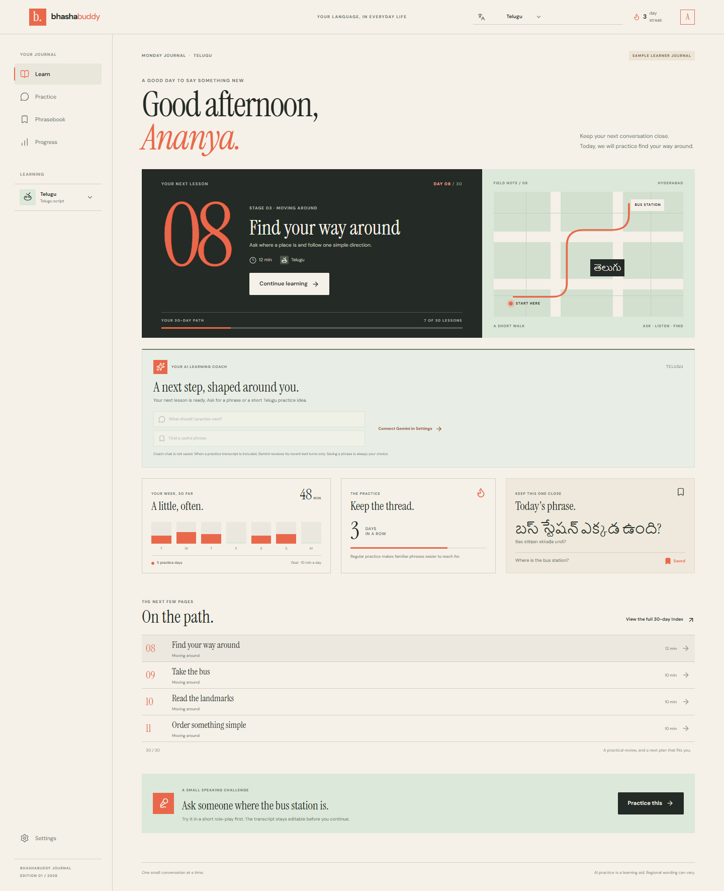
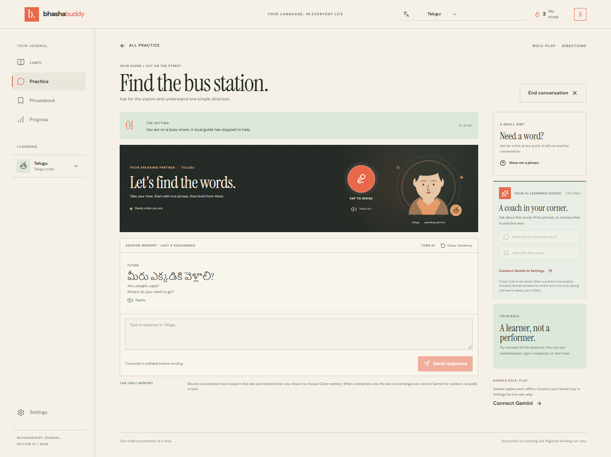
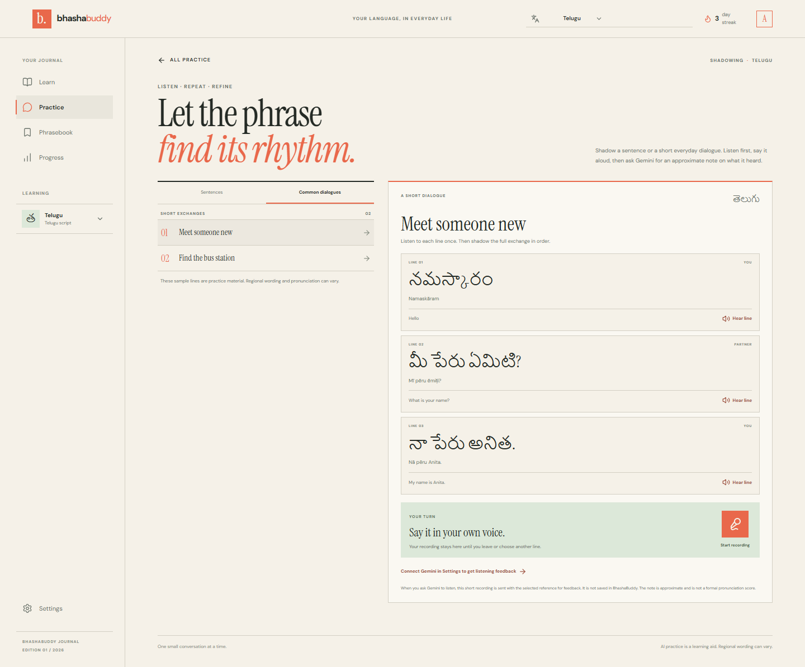
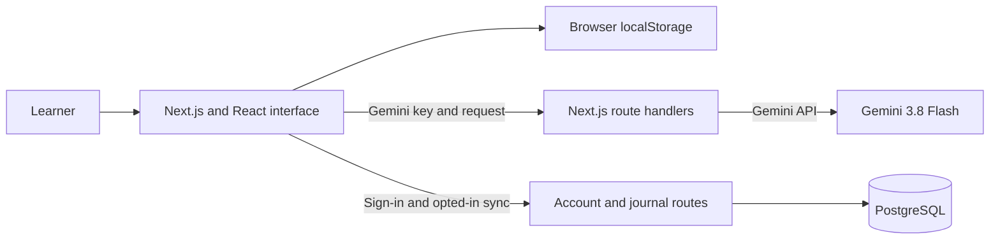

# BhashaBuddy

**Learn an Indian language through the conversations you have every day.**

BhashaBuddy is an AI-assisted language-learning journal for Telugu, Hindi, Tamil, Kannada, and Malayalam. Its 30-day path pairs short lessons and practical phrases with speaking practice, a reusable phrasebook, and a progress journal. A tool-using Gemini coach can help learners choose a next step, while Shadowing lets them listen, repeat, record, and request an approximate review.

The interface follows an editorial magazine direction: warm ivory pages, forest-green type, terracotta details, expressive serif headlines, and a responsive grid.

| Production app | Address |
| --- | --- |
| Vercel | [bhashabuddy-alpha.vercel.app](https://bhashabuddy-alpha.vercel.app/) |
| Render | [bhashabuddy.onrender.com](https://bhashabuddy.onrender.com/) |

## Contents

- [Product screenshots](#product-screenshots)
- [What learners can do](#what-learners-can-do)
- [Learner workflow](#learner-workflow)
- [How the AI coach works](#how-the-ai-coach-works)
- [Application workflow and architecture](#application-workflow-and-architecture)
- [Technology stack](#technology-stack)
- [Repository map](#repository-map)
- [Run locally](#run-locally)
- [Configure Gemini](#configure-gemini)
- [Optional PostgreSQL account sync](#optional-postgresql-account-sync)
- [API route reference](#api-route-reference)
- [Deployments](#deployments)
- [Scope and limitations](#scope-and-limitations)
- [License](#license)

## Product screenshots

Screenshots use the built-in Telugu sample journal. The sample has no real learner data.

### Learning dashboard

The dashboard brings together the current lesson, 30-day path, weekly practice, streak, saved phrase, and AI Learning Coach.



### Speaking practice

The role-play workspace offers a scenario, animated language tutor, voice or text input, session memory controls, and an optional coach panel.



### Shadowing

Learners can listen to each line of a common dialogue, record their own attempt, play it back, and request Gemini's approximate listening note.



## What learners can do

- **Follow a 30-day curriculum.** Each day has a practical objective, a short set of useful phrases, recall activities, and a place in a larger learning path.
- **Study five Indian languages.** Switch between Telugu, Hindi, Tamil, Kannada, and Malayalam. Phrases show the native script, transliteration, meaning, and a usage note.
- **Hear words and sentences.** Each phrase has a playback control. The app uses Gemini speech when a key is configured and falls back to the browser's speech synthesis when possible.
- **Practise everyday conversations.** Choose from scenes such as finding a bus station, ordering at a café, asking a market price, or meeting a classmate. Reply by typing or using supported browser speech recognition.
- **Use Shadowing.** Select a single sentence or a short dialogue, listen to its lines, record up to 15 seconds, review the recording, and explicitly send it to Gemini for a transcript and one approximate practice tip.
- **Ask the AI Learning Coach.** Request a next step, a useful phrase, a lesson guide, or a practice scene. The coach can look up real curriculum and phrasebook data rather than inventing an app action.
- **Keep a phrasebook and progress journal.** Bookmark phrases, record completed lessons and practice time, and review weekly activity and streaks.
- **Choose local or account-backed learning.** Guest learning works without an account or database. Optional accounts can sync a journal and, separately, tutor memory.

## Learner workflow

1. **Choose a language and learning preferences.** Select the target language, current level, daily time goal, and whether to focus on native script, transliteration, or both.
2. **Open the dashboard.** Continue the next lesson, review weekly activity, or use the 30-day index to see what is coming.
3. **Learn a practical phrase.** Read its native script and transliteration, listen to it, then work through recall prompts and examples.
4. **Use it in a scene.** Start a role-play and respond by voice or text. The sample tutor works without an API key; a checked Gemini key enables generated turns and speech where available.
5. **Repeat with Shadowing.** Choose a sentence or common dialogue, listen line by line, record a short attempt, and replay it before requesting Gemini feedback.
6. **Review with the coach.** Ask for a next step or a phrase to revisit. After a role-play, the learner can ask the coach to review recent transcript text. Saving a phrase or starting a scene always requires a learner click.
7. **Carry progress forward.** Lessons, bookmarks, and practice activity update the journal. A learner can use browser-only storage or sign in and select an account journal to sync.

## How the AI coach works

The Learning Coach is a constrained, tool-using assistant built around the learner's current language and progress. It can call four application-owned tools:

| Tool | Information returned |
| --- | --- |
| `get_learning_snapshot` | Current progress, learning goal, level, and next lesson |
| `search_phrases` | Matching phrases from BhashaBuddy's curated sample phrase set |
| `find_practice_scene` | One of the role-play scenes supported by the app |
| `get_lesson_guide` | A real day in the 30-day curriculum and its phrases |

The tools only read known app data. The model cannot write the journal or trigger navigation by itself. The interface renders suggested phrase and scene actions as buttons, and the learner chooses whether to save a phrase or begin the scene. Coach conversations are kept in component memory for the current view and are not stored as tutor memory.

## Application workflow and architecture



- **Browser interface:** The Next.js App Router hosts the landing page, onboarding, dashboard, lessons, phrasebook, progress, settings, role-play, and Shadowing. Reusable React components share the language selector, speech controls, tutor avatar, and coaching actions.
- **Local journal:** Guest state is restored from `localStorage`. The app can complete lessons, save phrases, and track practice without a server account.
- **AI requests:** The browser sends requests to Next.js route handlers. The handlers validate request shape and size, apply small in-memory rate limits, call Gemini, and validate structured responses before returning them.
- **Speech:** Browser `SpeechRecognition` is used when available for role-play transcription. `speechSynthesis` provides browser voice output. Gemini speech is an optional playback path when the learner has configured a key.
- **Shadowing audio:** `MediaRecorder` captures the learner's short recording in the browser. Audio remains in that view until the learner chooses **Ask Gemini to listen**; the app does not persist the recording. Gemini's text response is framed as approximate feedback, not a calibrated pronunciation score.
- **Account sync:** When `DATABASE_URL` is configured, account routes use PostgreSQL for accounts, sessions, learner journals, and opted-in tutor memory. Every account record is scoped to the signed-in account.

## Technology stack

| Area | Technologies | Use |
| --- | --- | --- |
| Web app | Next.js 16 App Router, React 19, TypeScript | Server-rendered routes, interactive client components, and API route handlers |
| UI | Tailwind CSS 4, shadcn/ui components, Lucide icons, custom CSS | Responsive layout, shared controls, and the editorial visual system |
| AI | Google Gemini API (`gemini-3.8-flash`, `gemini-3.8-flash-lite-tts`) | Flash handles role-play, Shadowing audio feedback, and tool-calling coach responses; Flash Lite TTS generates speech audio |
| Browser speech | Web Speech API, `MediaRecorder`, HTML audio | Speech recognition where supported, text-to-speech fallback, recording, and playback |
| Account storage | PostgreSQL, `pg` | Optional account, session, journal, and consent-based memory persistence |
| Hosting | Vercel and Render | Git-connected web deployments |

## Repository map

```text
app/
  [...slug]/                 App route entry for the learning journal
  api/
    auth/                   Register, login, logout, and session routes
    account/                Journal and tutor-memory sync routes
    gemini/                 Key validation, tutor, speech, coach, and Shadowing routes
  globals.css               Editorial theme, layouts, responsive rules, animations
components/bhashabuddy/     Dashboard, lessons, practice, Shadowing, settings, and shared UI
components/ui/              Reusable shadcn/ui-style controls
lib/
  bhashabuddy-data.ts       Curriculum, language metadata, and sample phrases
  demo-store.ts             Guest journal model and browser storage
  gemini-session.ts         Per-tab Gemini key and role-play memory helpers
  gemini-server.ts          Gemini model, request size, and rate-limit helpers
  account-server.ts         Password hashing, sessions, and account access helpers
  database.ts               PostgreSQL pool and schema initialization
  shadowing-data.ts         Sentence and dialogue practice sets
docs/screenshots/           README product screenshots
render.yaml                 Render web service configuration
```

## Run locally

### Requirements

- Node.js **22.13.0 or newer**
- npm
- PostgreSQL only if you want account creation and cross-device sync

### Install and start

```bash
git clone https://github.com/chaitanya-maddala-236/BhashaBuddy.git
cd BhashaBuddy
npm ci
npm run dev
```

Open [http://127.0.0.1:3000](http://127.0.0.1:3000). Choose **Explore sample** to open the seeded Telugu journal, or start onboarding to create a local learning profile.

### Available commands

```bash
npm run dev       # Start the local development server
npm run build     # Create a production build
npm start         # Run the production build locally
npm run lint      # Run ESLint
```

## Configure Gemini

Gemini is optional. The sample role-play runs without a key. To enable generated tutor turns, Gemini speech, the Learning Coach, and AI Shadowing feedback:

1. Open **Settings → Gemini speaking tutor**.
2. Paste a Gemini API key that you created in Google AI Studio.
3. Select **Check & save**. BhashaBuddy checks the model metadata before storing the key.
4. Return to Practice, Shadowing, or the Learning Coach.

The key is stored in that browser tab's `sessionStorage`, not in the account database or `.env` file. The app sends the key to its server route for Gemini requests; the server uses it for the Google API call and does not persist it. Gemini usage is subject to the key owner's Google project quota, billing settings, and data terms.

## Optional PostgreSQL account sync

The learning journal works locally without PostgreSQL. To enable accounts and cross-device sync:

1. Create or start a PostgreSQL database.
2. Copy `.env.example` to `.env.local`.
3. Set `DATABASE_URL` to the database's TLS-enabled PostgreSQL connection string. Keep it server-only; do not use a `NEXT_PUBLIC_` prefix.
4. Restart the app and use **Settings → Account & journal sync** to register or sign in.
5. After sign-in, choose whether to use the account journal or upload the journal from the current device.
6. Enable **Save tutor memory to this account** separately if you want role-play memory synced.

The app creates its PostgreSQL tables when account storage is first used; a manual migration command is not required. Passwords are stored as scrypt hashes, and session tokens are stored as digests and delivered in an HTTP-only, same-site cookie. Account journal and memory routes require the authenticated session.

Tutor memory is separate from the Learning Coach chat. Role-play memory is held in the current tab by default, limited to the most recent 12 messages (six exchanges) per language and scene, and cleared when the tab session ends. Cloud memory is opt-in. **Clear memory** removes the current scene's conversation; turning cloud memory off removes its saved conversation data. Deleting the cloud journal removes synced journal and memory while leaving the account and local browser journal intact.

## API route reference

| Route | Purpose |
| --- | --- |
| `POST /api/gemini/validate` | Validate the supplied Gemini key and model access |
| `POST /api/gemini/turn` | Generate a role-play response with bounded recent conversation context |
| `POST /api/gemini/speech` | Generate speech audio for a supported language |
| `POST /api/gemini/coach` | Run the tool-using Learning Coach against progress, phrase, scene, and lesson data |
| `POST /api/gemini/shadowing` | Send a selected reference and short audio recording for approximate feedback |
| `GET /api/auth/session` | Read the current account session |
| `POST /api/auth/register` | Create an account and session |
| `POST /api/auth/login` | Sign in and create a session |
| `POST /api/auth/logout` | End the current session |
| `GET/PUT/DELETE /api/account/state` | Read, update, or remove the signed-in account's cloud journal |
| `GET/PUT/DELETE /api/account/memory` | Read, update, or clear consent-based tutor memory |

## Deployments

Both production apps are connected to the GitHub `main` branch and build from the same source.

### Vercel

1. Import the GitHub repository as a Next.js project.
2. Use Node.js 22.13.0 or newer and the default Next.js build command, `npm run build`.
3. Add `DATABASE_URL` to the Vercel project only when enabling account sync.
4. Deploy the `main` branch. New commits trigger production deployments.

### Render

The repository includes `render.yaml`. It configures a Node web service with `npm ci && npm run build`, starts Next.js on `0.0.0.0`, and pins Node.js 22.13.0. Connect the GitHub repository to Render and apply the blueprint. Add `DATABASE_URL` in the Render environment when enabling account sync.

For accounts shared between Render and Vercel, configure both deployments with the **same private PostgreSQL connection string**. Use a TLS-enabled pooled URL when your database provider offers one. Never commit the production connection string. Render's free web service can spin down when idle, so the first request after inactivity may take longer.

## Scope and limitations

- Phrase and scenario content is sample learning material. It is not presented as independently reviewed by native speakers; regional wording, transliteration, and pronunciation vary.
- Browser speech recognition and speech synthesis depend on browser, operating system, installed voices, microphone permissions, and network conditions.
- Gemini's Shadowing feedback is an AI listening note. It can mishear a recording and is not a formal pronunciation assessment or accent score.
- Shadowing sends audio to Gemini only after the learner requests a check. BhashaBuddy does not save the recording.
- Password reset and email verification need a separate email delivery service and are not included.
- The login and Gemini request limits are in-process prototype limits. A multi-instance service should use a shared rate limiter.

## License

No license file is currently included. Contact the repository owner before redistributing this project.
